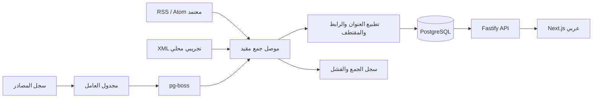

# بنية مدار

## قرار المرحلة الأولى

تطبيق معياري في مستودع واحد، وثلاث عمليات تشغيل مستقلة: Web وAPI وWorker. PostgreSQL 17 يحتفظ ببيانات النشر وطابور pg-boss في مخطط منفصل. لا بنية خدمات مصغرة أو ناقل رسائل مستقل في البداية.

## حدود الحزم

| المسار               | المسؤولية                                                 |
| -------------------- | --------------------------------------------------------- |
| `apps/web`           | صفحات عامة، طلبات خادم إلى API، بلا مفتاح إدارة في المتصفح |
| `apps/api`           | قراءة المواد، إدارة المصادر المحمية، وحجز المهام          |
| `apps/worker`        | جدولة المصادر المستحقة واستهلاك الطابور                    |
| `packages/contracts` | DTOs وأنواع الموصل وعقد المهمة                            |
| `packages/db`        | اتصالات PostgreSQL، معاملات، ترحيلات وحفظ النسخ              |
| `packages/ingestion` | RSS/Atom وتحصين الاتصال، دون اعتماد على قاعدة بيانات       |
| `scripts`            | إعداد البيئة والبناء والتشغيل واختبارات التكامل           |

## نموذج البيانات

`sources` يضم قناة الجمع وسياسة المحتوى وأساس الحقوق ووقت الجمع التالي ومحددات HTTP. `articles` يمثل المادة عند مصدر واحد. `article_revisions` يسجل كل تغير محفوظ؛ العودة من A إلى B ثم A تسجل ثلاث نسخ. `fetch_runs` يسجل نتيجة كل محاولة وعدد الإدخالات والتعديلات، مع رموز فشل لا تسرب روابط أو أسرارًا.

`stories` و`story_articles` أساس ربط القصص تحريريًا في المرحلة التالية، وهما غير معبأين الآن. لم تُنشأ جداول حسابات أو تفضيلات شخصية قبل تحديد الهوية والخصوصية.

هوية المادة: `(source_id, canonical_url)`؛ لا نحذف مقالات ناشرين مختلفين لمجرد تطابق النص. `contentHash` يتجاهل وقت الرصد والنشر وGUID، ويقارن الرابط والعنوان والمقتطف المسموح. هذا **كشف تغير النص**، وليس إثبات ظهور معلومة جديدة. رابط متغير أو معاملات تتبع مختلفة قد ينتجان مادة أخرى؛ قواعد التطبيع الخاصة بكل ناشر مؤجلة حتى اختبارها.

## تدفق الجمع

1. المجدول يبحث كل 30 ثانية عن مصادر مستحقة؛ حد الدفعة 100، وفاصل المصدر 60 ثانية إلى يوم.
2. الطابور يستخدم `exclusive` ومفتاح المصدر لمنع المهمة المتزامنة المكررة. عاملان محليان يجمعان مصادر مختلفة.
3. الموصل يتحقق من التفعيل والحقوق وبوابة الشبكة. Fixtures مسموحة في التطوير والاختبارات فقط.
4. RSS يستخدم HTTPS والمنفذ443، نطاقات صريحة، تحقق DNS عام وتثبيت عنوان الاتصال، حد8 ثوانٍ وحد1MB، ولا يتبع التحويلات. الطلب الشرطي يرسل ETag/Last-Modified؛304 لا ينشئ مادة.
5. المعاملة تقفل سجل المصدر، تعيد التحقق من الاعتماد، تحفظ المواد والنسخ، وتحدث وقت الجمع وسجله معًا. تكرار التنفيذ بعد الانقطاع لا يكرر المادة غير المتغيرة.
6. عند الفشل، يسجل رمز مختصر وتؤجل دورة المصدر؛ الطابور يعيد المحاولة حتى3 مرات بتأخير تصاعدي، ثم ينقل المهمة إلى طابور الفشل. النسخ الاحتياطي يشمل مخطط `pgboss`.

النقل بالمهام قابل لإعادة التنفيذ؛ لا ندعي ضمانًا مطلقًا لـexactly-once لكل أثر خارجي. لا إشعارات أو مدفوعات خارجية في المرحلة الحالية.

## قرار العرض

القراءة تخفي مواد المصادر غير المعتمدة. `enabled=false` يوقف الجمع مع بقاء المواد السابقة المعتمدة؛ `rightsStatus=blocked` يخفيها. `metadata_only` يحجب المقتطفات الحالية والتاريخية من API، لكنه لا يمحو النسخ القديمة من التخزين تلقائيًا. طلب الإزالة الكاملة يحتاج إجراء حذف مدروس يشمل النسخ الاحتياطية وسياسة الاحتفاظ.

واجهة الإنتاج لا تعرض Fixtures ولو وصلت قاعدة تطوير بالخطأ. ترتيب الصفحات بالوقت ومعرف المادة، وبطابع وقت بدقة المللي ثانية لتجنب فقد عناصر في المؤشر. وقت النشر منقول عن المصدر، ووقت الرصد من الخادم.

## التوسع اللاحق

زد عدد العمال بعد قياس ضغط المصادر والطابور. افصل قواعد التحليل عن الجمع، وأضف موصلات بحسب حقوق كل مصدر. Redis أو بحث مستقل أو تخزين كائنات تُضاف عند وجود احتياج مقاس، لا شرطًا مبكرًا. PostgreSQL الحالي لا يمثل أرشيف النصوص والصور الكاملة.

مراجع تنفيذ: [Fastify](https://fastify.dev/docs/latest/)، [Next.js](https://nextjs.org/docs/app/getting-started/deploying)، [pg-boss](https://github.com/timgit/pg-boss)، [سياسة build في pnpm](https://pnpm.io/settings#allowbuilds). الإصدارات الفعلية مثبتة في manifests وlockfile؛ لا تعتمد الوثيقة على افتراض `latest`.

## تطبيق iOS التجريبي — امتداد 17 نوفمبر 2026

أضيف `apps/ios` بطلب صريح من المستخدم، وفق [مواصفة النسخة](IOS-PHASE-1-SPEC.md). يستخدم SwiftUI وحزمة `MadarCore` المحلية، دون ربط بـAPI الحالي. يختبر تجربة القصص والمتابعة المشروطة بسيناريوهات افتراضية وحفظ محلي؛ لا ينفذ جمعًا أو استنتاجًا تحريريًا أو إرسال إشعارات. ربطه بالمنتج الحي يحتاج عقد تطورات ومصادر مستقلًا، ولا يغيّر هذه الإضافة بنية الخادم.
